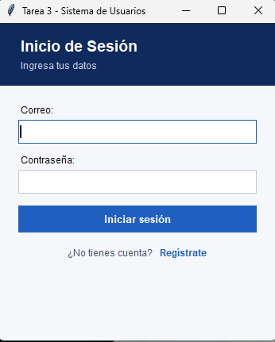
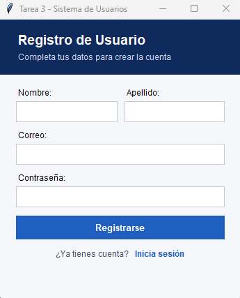
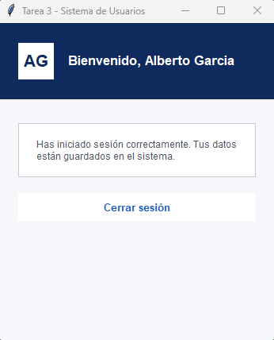
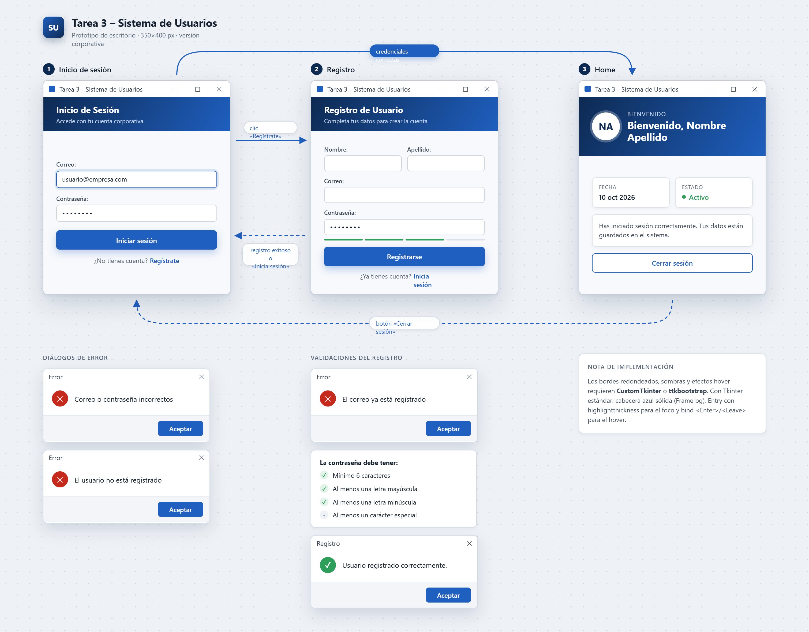

# Tarea 3 - Sistema de Usuarios con Tkinter

Tarea 3: Introducción a Tkinter, del curso Razonamiento Artificial de la Certificación de Inteligencia Artificial, Universidad Creativa de Costa Rica.

## Autores

- Alberto García
- Jurgen Solano

## Descripción

Aplicación de escritorio hecha con Python y Tkinter que simula un flujo básico de registro, inicio de sesión y pantalla principal. Incluye validación de datos y guarda los usuarios en un archivo JSON.

## Flujo de la aplicación

```
 Inicio de Sesión ──(Regístrate)──▶ Registro
       ▲   │                           │
       │   │ credenciales correctas    │ registro exitoso
       │   ▼                           │ o "Inicia sesión"
       │  Home                         │
       │   │                           │
       └───┴───(Cerrar sesión)◀────────┘
```

- Registro exitoso → vuelve a Inicio de Sesión.
- Inicio de sesión correcto → Home.
- Cerrar sesión → vuelve a Inicio de Sesión.

## Requisitos

- Python 3.8 o superior.
- Tkinter (viene incluido con Python en Windows y macOS; en Linux puede requerir `sudo apt install python3-tk`).
- No se necesitan librerías externas.

## Cómo ejecutar

```bash
git clone https://github.com/jurgen1138/tarea3_razonamientoia_tkinter.git
cd tarea3_razonamientoia_tkinter
python main.py
```

Si `python` no funciona, usar `py main.py`.

## Estructura del proyecto

| Archivo | Contenido |
|---|---|
| `main.py` | Punto de entrada: crea la ventana y abre el login |
| `login.py` | Pantalla de Inicio de Sesión |
| `registro.py` | Pantalla de Registro y validación de contraseña |
| `home.py` | Pantalla principal |
| `datos.py` | Lectura y escritura de usuarios en JSON |
| `estilos.py` | Colores y widgets compartidos entre pantallas |
| `diseno/` | Mockup de las pantallas hecho en Claude Design |

## Datos

Los usuarios se guardan en `usuarios.json`, en la misma carpeta que los `.py`. El archivo se crea solo al registrar el primer usuario y está en el `.gitignore`, por lo que no se sube al repositorio.

Formato:

```json
[
    {
        "nombre": "Ana",
        "apellido": "Pérez",
        "correo": "ana@correo.com",
        "contrasena": "Hola123!"
    }
]
```

## Manual de uso

### Cómo registrarse
1. En el Inicio de Sesión, clic en **Regístrate**.
2. Completar nombre, apellido, correo y contraseña.
3. La contraseña debe tener:
   - Mínimo 6 caracteres.
   - Al menos una letra mayúscula.
   - Al menos una letra minúscula.
   - Al menos un carácter especial (por ejemplo `!`, `#`, `$`).
4. Clic en **Registrarse**. Aparece un mensaje de confirmación y vuelve al login.

### Cómo iniciar sesión
1. Escribir el correo y la contraseña registrados.
2. Clic en **Iniciar sesión** (o presionar Enter).
3. Se abre el Home con "Bienvenido, Nombre Apellido".
4. Para salir, clic en **Cerrar sesión**.

### Errores comunes

| Mensaje | Causa | Qué hacer |
|---|---|---|
| Debe completar todos los campos. | Hay campos vacíos | Llenar todos los campos |
| El correo ya está registrado. | Ya existe un usuario con ese correo | Iniciar sesión o usar otro correo |
| Debe tener mínimo 6 caracteres / mayúscula / minúscula / carácter especial | La contraseña no cumple las reglas | Corregir la contraseña según lo indicado |
| El usuario no está registrado | El correo no existe | Registrarse primero |
| Correo o contraseña incorrectos | La contraseña no coincide | Revisar la contraseña e intentar de nuevo |

## Capturas de pantalla







## Diseño previo



Archivo: [diseno/mockup-pantallas.png](diseno/mockup-pantallas.png).
